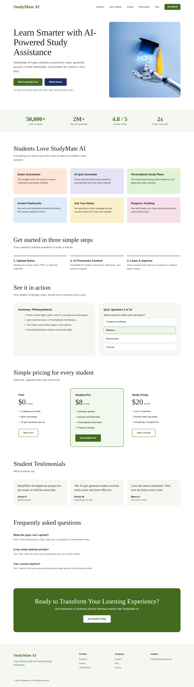

# StudyMate AI: Landing Page

A light-theme landing page for **StudyMate AI**, an AI-powered study assistant that helps students summarize notes, generate quizzes, create flashcards, and prepare for exams in less time.

This repository holds the landing page design as a PNG and the HTML/CSS source it was rendered from.

## Preview



## Files

| File | Description |
| --- | --- |
| `StudyMate_AI_Landing_Page.png` | Full-length landing page design (1440 × 5086 px) |
| `index.html` | Single-file HTML and CSS source of the page |
| `hero.png` | Hero image used in `index.html` |
| `README.md` | This file |

## Page Sections

1. **Header:** logo, navigation (Features, How It Works, Pricing, Testimonials, FAQ) and a Get Started button
2. **Hero:** headline, short description, *Start Learning Free* and *Watch Demo* buttons, hero image
3. **Stats strip:** key numbers about students, quizzes, rating and prep time
4. **Features:** Smart Summaries, AI Quiz Generator, Personalized Study Plans, Instant Flashcards, Ask Your Notes, Progress Tracking
5. **How It Works:** Upload Notes, AI Processes Content, Learn & Improve
6. **See It in Action:** sample summary and sample quiz question
7. **Pricing:** Free, Student Pro, Study Group
8. **Student Testimonials**
9. **FAQ**
10. **Call to Action:** *Ready to Transform Your Learning Experience?*
11. **Footer:** product and company links, contact email, copyright

## Design System

| Token | Value | Use |
| --- | --- | --- |
| Primary green | `#446a1f` | Logo, main buttons, highlights |
| Dark green | `#2f4d14` | Button text on the CTA banner |
| Navy | `#1f2d6b` | Secondary button (*Watch Demo*) |
| Surface | `#f5f7f2` | Section backgrounds, cards |
| Border | `#e3e7dc` | Dividers and outlines |
| Text | `#1b1f17` | Body copy |
| Muted text | `#555c4e` | Secondary copy |

Feature cards use soft pastel tints (peach, lavender, mint, sky, butter, rose) to keep the page light and friendly.

**Typography:** Liberation Serif for the logo and headings, Liberation Sans for body text and UI. Swap in your own brand fonts in the `font` declarations at the top of `index.html`.

## Usage

**View the page:** open `index.html` in any modern browser. Keep `hero.png` in the same folder.

**Re-export the PNG** (requires Python and [Playwright](https://playwright.dev/python/)):

```bash
pip install playwright
playwright install chromium
```

```python
from playwright.sync_api import sync_playwright

with sync_playwright() as p:
    browser = p.chromium.launch()
    page = browser.new_page(viewport={"width": 1440, "height": 900})
    page.goto("file:///absolute/path/to/index.html")
    page.screenshot(path="StudyMate_AI_Landing_Page.png", full_page=True)
    browser.close()
```

## Customization

- **Copy:** edit the text directly in `index.html`.
- **Colors:** change the CSS variables in the `:root` block at the top of the stylesheet.
- **Hero image:** replace `hero.png` with your own image of similar proportions.
- **Placeholder content:** the stats, pricing plans, FAQ answers, testimonial names, and demo content are placeholders. Replace them with real data before publishing.

## Notes

- The design is desktop-first at 1440 px wide. It is not yet responsive for tablet or mobile.
- Buttons and navigation links are visual only; they are not wired to real pages.

## Contact

hello@studymateai.com

© 2026 StudyMate AI. All Rights Reserved.
